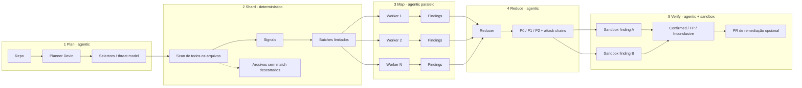
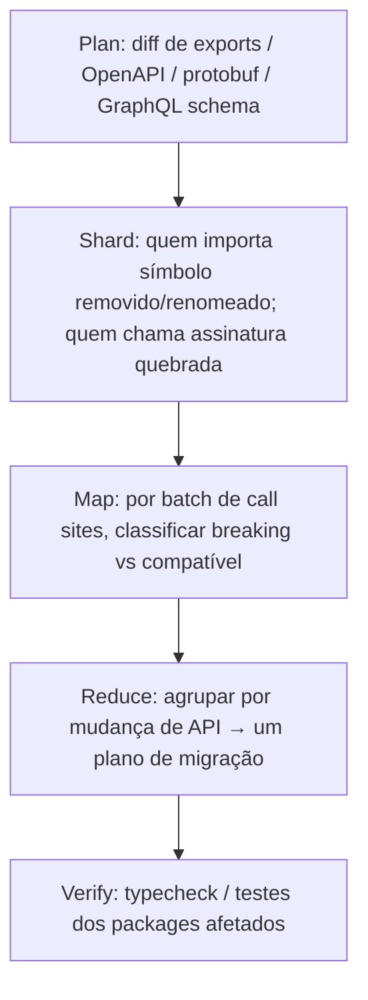
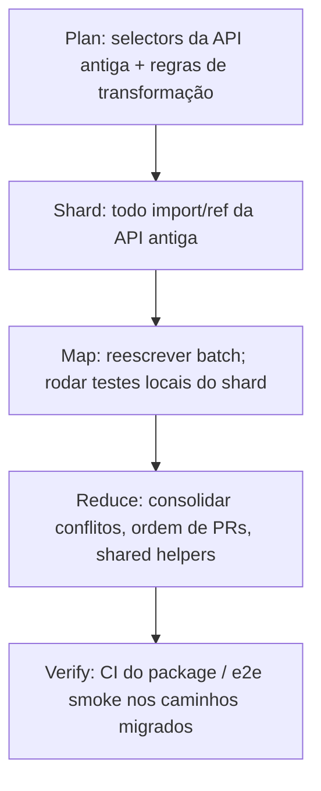

# Agentic MapReduce: pipeline, comparação e reaplicação

Fonte: [Agentic MapReduce](https://devin.ai/blog/agentic-map-reduce) · [Evaluating Security Swarm](https://devin.ai/blog/security-swarm-eval) · [Introducing Security Swarm](https://cognition.com/blog/introducing-devin-security-swarm)

---

## Sumário

1. [Pipeline Plan → Verify](#a-pipeline-plan--verify)
2. [Comparação com Cursor e swarms genéricos](#b-comparação-com-cursor-e-swarms-genéricos)
3. [Reaplicar em breaking changes e migração](#c-reaplicar-em-breaking-changes-e-migração)

---

## A. Pipeline Plan → Verify

### Visão geral



### Estágio a estágio

#### 1. Plan (agentic)

Um Devin estuda o repo e escreve selectors: testes de relevância concretos o bastante para rodar sem LLM.

Em Security Swarm isso vira um threat model editável (rotas, auth wrappers, sinks de deserialização, APIs perigosas). Em scan interativo, humano revisa antes do fan-out.

Gasto de raciocínio: uma vez. Depois o custo se amortiza em execuções determinísticas e reuso do perfil.

#### 2. Shard (determinístico)

Selectors rodam em cada arquivo. Cada match emite um signal (path, selector, evidência). Arquivos sem signal nunca chegam ao Map.

Signals viram batches. Completeness = fila finita esgotada. O gargalo real muda de "o agente procurou bem?" para "os selectors têm recall?".

#### 3. Map (agentic, paralelo)

Um child Devin por batch, contexto limpo: signals do shard + proveniência da regra. Lê código ao redor, aplica false-positive gate, emite findings estruturados (severidade, confiança, precondições). Workers com zero findings somem do Reduce.

Custo passa a acompanhar código relevante, não tamanho do monorepo.

#### 4. Reduce (agentic)

Consome conclusões comprimidas, não transcripts. Dedup, ownership, triage P0/P1/P2, e cadeias cross-shard.

Exemplo: leak de ID sem auth + RCE gated por ID → um P0 RCE não autenticado.

#### 5. Verify (agentic + runtime)

Fan-out de sandboxes contra build rodando. Labels: Confirmed / False Positive / Inconclusive. Confirmados podem virar PR.

Sem Verify, o sistema ainda é um scanner agentic forte. Com Verify, o output vira "exploitable agora" em vez de "cheira a bug".

### Artefatos e contratos

| Artefato | Produzido em | Consumido por | Propriedade útil |
|---|---|---|---|
| Selectors / threat model | Plan | Shard | Inspecionável, versionável, testável |
| Signals | Shard | Map | Proveniência explícita |
| Batches | Shard | Map | Bound de custo e contexto |
| Findings estruturados | Map | Reduce | Sem precisar do transcript |
| Attack chains + triage | Reduce | Verify / humano | Visão global |
| Confirmed / FP / Inconclusive | Verify | Remediação | Prova de runtime |

### Onde o custo entra

```text
custo ≈ Plan(1×)
      + Shard(CPU barato, repo inteiro)
      + Map(N × shard_relevante)
      + Reduce(conclusões, não código)
      + Verify(só findings sérios)
      + (re-runs) só o diff desde o último scan
```

Alavanca de produto: `batch size` no scan profile. Batches menores = mais workers, mais profundidade, mais custo.

### Falhas por estágio

| Estágio | Se falhar | Sintoma |
|---|---|---|
| Plan | Selector recall baixo | Bugs em arquivos "inofensivos" nunca entram no Map |
| Shard | Bug no runner / query | Cobertura falsa (parecer completo, miss silencioso) |
| Map | FP gate frouxo ou contexto curto demais | Ruído ou miss local |
| Reduce | Schema de finding frouxo | Cadeias quebradas, duplicatas, prioridade errada |
| Verify | Build não sobe | Muitos Inconclusive; time perde confiança |

---

## B. Comparação com Cursor e swarms genéricos

### Quadro rápido

| Dimensão | Agentic MapReduce (Devin Security Swarm) | Cursor subagents / multitask | Cursor Cloud Agents | Swarm genérico (CrewAI / AutoGen / OpenAI Swarm) |
|---|---|---|---|---|
| Unidade de trabalho | Signal → batch finito | Subtask do prompt do pai | Run isolado (VM + branch) | Role / mensagem / handoff |
| Quem decide o que analisar | Planner escreve selectors; shard determinístico | Pai (ou `/multitask`) decompõe em linguagem natural | Quem lança o run (humano/API/pai) | LLM roteia ou você fixa o grafo |
| Cobertura | By construction (fila esgota) | Heurística: para quando o pai/workers acham suficiente | Por tarefa: cada run cobre o escopo do prompt | Quase sempre heurística |
| Paralelismo | N workers Map + Verify | Subagents foreground/background; `/multitask` async | N runs, cada um em VM/worktree | Crew paralelo ou group chat |
| Isolamento de contexto | Fresh child session por batch | Context window própria; pai só vê o summary | Isolamento forte (VM + branch) | Variável; chat costuma compartilhar histórico |
| Reduce global | Redutor agentic sobre findings | Pai agrega summaries ad hoc | Você agrega PRs/resultados fora | Manager / human / último speaker |
| Determinismo da seleção | Sim (selectors) | Não | Não | Não (salvo grafo LangGraph-like) |
| Runtime proof | Sandbox Verify no pipeline | Depende do que o agente rodar | Pode testar no ambiente do run | Raro como estágio de produto |
| Melhor para | Whole-repo com completeness (security, quality, breaking change) | Pesquisa + implementação local em paralelo | Frota de tarefas independentes com PRs | Pipelines de roles ou debate aberto |
| Fraqueza típica | Selector miss = buraco silencioso | Sem fila finita; exploração ainda come budget | Sem MapReduce nativo; cobertura = soma dos prompts | Custo e não-determinismo de roteamento |

### Cursor: o que é o quê

**Subagents (editor/CLI/cloud).** Delegação dentro de uma sessão. Explore / Bash / Browser existem justamente para isolar output barulhento. Custom agents em `.cursor/agents/`. Pai passa contexto no prompt; filho não herda o histórico.

**`/multitask` (Agents Window).** Quebra um pedido grande em chunks ou transforma fila de prompts em subagents async. Pai fica interativo. Bom para frota de trabalho local. Não gera selectors determinísticos nem garante que o repo inteiro foi tocado.

**Cloud Agents.** Cada run: VM própria, branch/worktree, PR. Encaixa "18 tarefas independentes, 18 PRs". É isolamento operacional, não cobertura whole-repo. Um Cloud Agent sozinho ainda é search-driven no escopo do prompt.

Leitura prática: Cursor já tem o *Map* (workers paralelos com contexto limpo) e um *Reduce* fraco (summary de volta ao pai). Falta o *Plan→Shard determinístico* que transforma "procure vulnerabilidades" em fila finita e auditável. Dá para aproximar Agentic MapReduce *em cima* do Cursor: um agente Plan gera queries Tree-sitter / ripgrep versionadas; um script Shard emite JSON de signals; N Cloud Agents ou subagents fazem Map; um agente Reduce consome só o JSON.

### Swarms genéricos

| Família | Modelo mental | Relação com Agentic MapReduce |
|---|---|---|
| CrewAI | Roles + tasks em linha ou hierarquia | Parece assembly line; seleção de arquivos ainda é tipicamente agentic/grep |
| AutoGen / AG2 | Conversa / group chat | Forte em iterar código+execução; fraco em cobertura verificável de monorepo |
| OpenAI Swarm | Handoffs leves via function call | Orquestração mínima; você monta o MapReduce na mão |
| LangGraph | Grafo explícito com edges | Melhor base para *implementar* Plan→Shard→Map→Reduce com estágio determinístico |

O nome "swarm" em Security Swarm não é o Swarm da OpenAI. É fan-out de Devins no estágio Map (+ Verify). O diferencial não é "muitos agentes", é **seleção determinística + reduce com schema**.

### Decisão rápida

```text
Precisa afirmar "todo arquivo relevante foi considerado"?
  sim → Agentic MapReduce (ou clone: selectors + fila + workers + reduce)
  não →

Tarefas independentes com PRs isolados?
  sim → Cursor Cloud Agents em paralelo
  não →

Mesma sessão, vários workstreams, contexto do pai importa?
  sim → Cursor subagents / multitask
  não →

Roles conversando / debate / pipeline de conteúdo?
  sim → CrewAI / AutoGen / Swarm
```

---

## C. Reaplicar o padrão

Dois domains onde a mesma forma encaixa: breaking-change detection e large-scale migration.

### C1. Breaking-change detection

**Objetivo.** Dado um diff de API (lib interna ou pacote publicado), listar todo consumer afetado e um plano de migração ranqueado. Confiável só se o monorepo (ou a frota de repos) inteiro entrou na conta.



**Selectors (exemplos).**

- Diff de `export` / `pub` / `public` entre tag anterior e HEAD
- Comparação de OpenAPI / protobuf / JSON Schema gerados
- Query de call graph / imports para cada símbolo removido ou com assinatura alterada
- Em monorepo: workspace graph (pnpm/nx/bazel) para afetados transitivos

**Signals.** `{ symbol, change_kind, consumer_path, evidence }`

**Map worker.** Para cada batch de consumers: o call site quebra? Há overload/compat shims? Severity (compile-break vs behavioral).

**Reduce.** Uma entrada por mudança de API, com lista de call sites, owners, e ordem sugerida de migração. Cross-shard: o mesmo símbolo quebrando três packages vira um item, não três.

**Verify.** `tsc` / `cargo check` / `pytest` nos packages tocados; ou build dos consumers em sandbox. Confirmed = ainda falha no check. Remediação = PR de adaptadores ou bump coordenado.

**Scan profile.** "API public surface only" vs "incluindo internals cross-package". Batch size = packages por worker.

### C2. Large-scale migration

**Objetivo.** Trocar uma interface (ex.: `requests` → `httpx`, Auth0 SDK v2 → v3, CSS modules → Tailwind tokens) em todo o codebase, com PRs revisáveis e cobertura completa de call sites.



**Selectors.**

- Imports e FQNs da API antiga (Tree-sitter / compiler)
- Strings de config / DI registration
- Feature flags que ainda apontam para o path legado

**Map worker.** Aplica a migração no shard, sobe testes do módulo, reporta `{ files_changed, residual_refs, test_status, blockers }`.

**Reduce.** Une leftovers, detecta helpers compartilhados que vários shards tentaram criar em paralelo, define sequência de merge (lib core antes dos apps).

**Verify.** CI verde nos packages; smoke e2e nos fluxos que tocavam a API antiga. Residual refs após Reduce = miss de selector ou falso negativo do Map.

**Diferença vs security.** No Map a ação é *editar*, não só *julgar*. O Reduce vira merge planner. Verify é CI, não exploit sandbox. A espinha Plan→Shard→Map→Reduce continua igual.

### Esqueleto mínimo (pseudo)

```text
plan(repo, task) -> selectors[]          # agentic, 1×
shard(repo, selectors) -> signals[]      # deterministic
batches = pack(signals, batch_size)      # deterministic
findings[] = parallel map(batch -> worker(batch))  # agentic
result = reduce(findings)                # agentic
verified = parallel verify(result.serious)  # agentic + runtime/CI
persist(selectors) for incremental re-runs on git diff
```

### Checklist para portar o padrão

1. A tarefa só é confiável com cobertura total?
2. Dá para escrever um teste de relevância determinístico (AST, schema diff, call graph)?
3. O output do Map cabe num schema estável (finding / call_site / migration_unit)?
4. Existe um Reduce que precise de visão cross-shard (cadeias, um plano, helpers compartilhados)?
5. Existe um Verify objetivo (exploit, typecheck, CI)?
6. Re-runs podem restringir ao diff?

Se 1–3 forem "não", Agentic MapReduce é overkill. Um subagent Cursor ou um Cloud Agent resolve.

---

## Referências

- Cognition, *Agentic MapReduce* — https://devin.ai/blog/agentic-map-reduce
- Cognition, *Evaluating Security Swarm* — https://devin.ai/blog/security-swarm-eval
- Cognition, *Introducing Devin Security Swarm* — https://cognition.com/blog/introducing-devin-security-swarm
- Dean & Ghemawat, *MapReduce* (OSDI 2004)
- Cursor Docs, *Subagents* — https://cursor.com/docs/subagents
- Zhang et al., *FastContext* (2026), citado no post Agentic MapReduce
